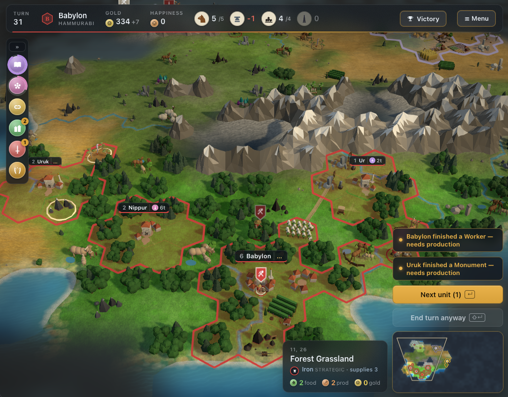
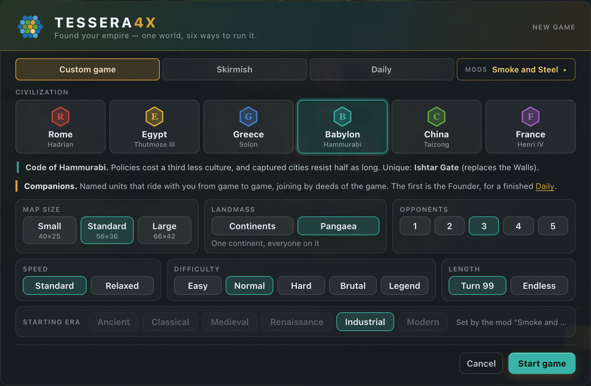
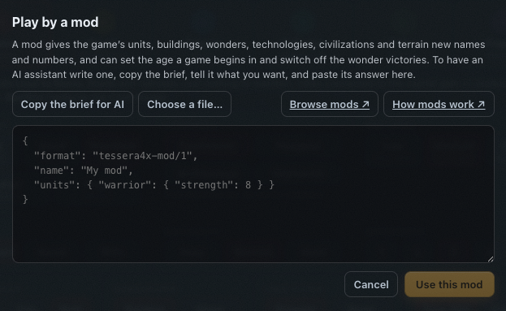

# Tessera4X Mods

Mods for [Tessera4X](https://tessera4x.com): *Build an empire, tile by
tile: a turn-based 4X strategy game in your browser.*

Each mod here is one small JSON file that renames and retunes the game's
units, buildings, wonders, technologies, civilizations and terrain, and can
choose the age a game begins in and which victories are open.

## Play a mod

- **One click.** Every mod below has a **Play** link. It opens Tessera4X with
  the mod already loaded. There's nothing to install.
- **From the file.** Download a mod's `mod.json`. In the game, open
  **New game**, press **Mods**, and choose the file or paste its text.

A mod travels with its game. It's kept in your saves, and the game's
**Share** link carries it to a friend.

*The New game screen under Smoke and Steel. The mod sets the starting era, so
the era row is locked to Industrial.*

## The mods

<!-- catalogue:start -->
| Mod | What it does | Play |
|-----|--------------|------|
| [The Great Works](mods/great-works) | An age of builders. The ancient wonders come cheaper and give more, monuments raise culture faster, and any capital can make a run at one. The Concord sits a little further off, to keep the clock honest. | [Skirmish][great-works-skirmish] · [Full game][great-works-full] |
| [Kings of Bronze](mods/kings-of-bronze) | The Late Bronze Age, around 1300 BC: six great kingdoms trade letters and blows. Bronze is cheap, iron is a secret, chariots rule the field, and the ancient era lasts. | [Skirmish][kings-of-bronze-skirmish] · [Full game][kings-of-bronze-full] |
| [Open Frontier](mods/open-frontier) | An empty continent and cheap pioneers: the land rush starts on turn one. Land is cheap; holding it is not. Walls come dear, and every new town strains the peace. | [Skirmish][open-frontier-skirmish] · [Full game][open-frontier-full] |
| [Smoke and Steel](mods/smoke-and-steel) | Last empire standing. The world wakes in the age of rails and rifles with the Concord, the Meridian and the Laurel Arch switched off: take every rival city, or hold the best score when the clock runs out. The war is fought on land. *Industrial start · conquest or score only* | [Skirmish][smoke-and-steel-skirmish] · [Full game][smoke-and-steel-full] |
| [Warring Dawn](mods/warring-dawn) | Every neighbour is a threat from the first turn. Soldiers come cheap and hit harder, walls come late and dear, and borders grow slowly in an age of raids. | [Skirmish][warring-dawn-skirmish] · [Full game][warring-dawn-full] |

[great-works-skirmish]: https://tessera4x.com/#world=skirmish&seed=276767781&mod=eyJmb3JtYXQiOiJ0ZXNzZXJhNHgtbW9kLzEiLCJuYW1lIjoiVGhlIEdyZWF0IFdvcmtzIiwiYXV0aG9yIjoiVGVzc2VyYTRYIiwiZGVzY3JpcHRpb24iOiJBbiBhZ2Ugb2YgYnVpbGRlcnMuIFRoZSBhbmNpZW50IHdvbmRlcnMgY29tZSBjaGVhcGVyIGFuZCBnaXZlIG1vcmUsIG1vbnVtZW50cyByYWlzZSBjdWx0dXJlIGZhc3RlciwgYW5kIGFueSBjYXBpdGFsIGNhbiBtYWtlIGEgcnVuIGF0IG9uZS4gVGhlIENvbmNvcmQgc2l0cyBhIGxpdHRsZSBmdXJ0aGVyIG9mZiwgdG8ga2VlcCB0aGUgY2xvY2sgaG9uZXN0LiIsImJ1aWxkaW5ncyI6eyJtb251bWVudCI6eyJjb3N0Ijo0MCwiY3VsdHVyZSI6M319LCJ3b25kZXJzIjp7InN0b25laGVuZ2UiOnsiY29zdCI6MTEwLCJjdWx0dXJlIjo1fSwidGVtcGxlT2ZBcnRlbWlzIjp7ImNvc3QiOjEyMCwieWllbGRzIjp7ImZvb2QiOjR9fSwicHlyYW1pZHMiOnsiY29zdCI6MTMwLCJjdWx0dXJlIjoyfSwiZ3JlYXRMaWJyYXJ5Ijp7ImNvc3QiOjE2MH0sImNvbG9zc3VzIjp7ImNvc3QiOjE1MH0sImhhbmdpbmdHYXJkZW5zIjp7ImNvc3QiOjE3MCwieWllbGRzIjp7ImZvb2QiOjZ9fSwicG9udER1R2FyZCI6eyJjb3N0IjoxOTB9LCJjb25jb3JkIjp7ImNvc3QiOjcyMH19LCJ0ZWNocyI6eyJtaW5pbmciOnsiY29zdCI6Mjh9LCJtYXNvbnJ5Ijp7ImNvc3QiOjQwfSwiYnJvbnplV29ya2luZyI6eyJjb3N0Ijo0NX19fQ
[great-works-full]: https://tessera4x.com/#world=custom&seed=276767781&mod=eyJmb3JtYXQiOiJ0ZXNzZXJhNHgtbW9kLzEiLCJuYW1lIjoiVGhlIEdyZWF0IFdvcmtzIiwiYXV0aG9yIjoiVGVzc2VyYTRYIiwiZGVzY3JpcHRpb24iOiJBbiBhZ2Ugb2YgYnVpbGRlcnMuIFRoZSBhbmNpZW50IHdvbmRlcnMgY29tZSBjaGVhcGVyIGFuZCBnaXZlIG1vcmUsIG1vbnVtZW50cyByYWlzZSBjdWx0dXJlIGZhc3RlciwgYW5kIGFueSBjYXBpdGFsIGNhbiBtYWtlIGEgcnVuIGF0IG9uZS4gVGhlIENvbmNvcmQgc2l0cyBhIGxpdHRsZSBmdXJ0aGVyIG9mZiwgdG8ga2VlcCB0aGUgY2xvY2sgaG9uZXN0LiIsImJ1aWxkaW5ncyI6eyJtb251bWVudCI6eyJjb3N0Ijo0MCwiY3VsdHVyZSI6M319LCJ3b25kZXJzIjp7InN0b25laGVuZ2UiOnsiY29zdCI6MTEwLCJjdWx0dXJlIjo1fSwidGVtcGxlT2ZBcnRlbWlzIjp7ImNvc3QiOjEyMCwieWllbGRzIjp7ImZvb2QiOjR9fSwicHlyYW1pZHMiOnsiY29zdCI6MTMwLCJjdWx0dXJlIjoyfSwiZ3JlYXRMaWJyYXJ5Ijp7ImNvc3QiOjE2MH0sImNvbG9zc3VzIjp7ImNvc3QiOjE1MH0sImhhbmdpbmdHYXJkZW5zIjp7ImNvc3QiOjE3MCwieWllbGRzIjp7ImZvb2QiOjZ9fSwicG9udER1R2FyZCI6eyJjb3N0IjoxOTB9LCJjb25jb3JkIjp7ImNvc3QiOjcyMH19LCJ0ZWNocyI6eyJtaW5pbmciOnsiY29zdCI6Mjh9LCJtYXNvbnJ5Ijp7ImNvc3QiOjQwfSwiYnJvbnplV29ya2luZyI6eyJjb3N0Ijo0NX19fQ
[kings-of-bronze-skirmish]: https://tessera4x.com/#world=skirmish&seed=1011728498&mod=eyJmb3JtYXQiOiJ0ZXNzZXJhNHgtbW9kLzEiLCJuYW1lIjoiS2luZ3Mgb2YgQnJvbnplIiwiYXV0aG9yIjoiVGVzc2VyYTRYIiwiZGVzY3JpcHRpb24iOiJUaGUgTGF0ZSBCcm9uemUgQWdlLCBhcm91bmQgMTMwMCBCQzogc2l4IGdyZWF0IGtpbmdkb21zIHRyYWRlIGxldHRlcnMgYW5kIGJsb3dzLiBCcm9uemUgaXMgY2hlYXAsIGlyb24gaXMgYSBzZWNyZXQsIGNoYXJpb3RzIHJ1bGUgdGhlIGZpZWxkLCBhbmQgdGhlIGFuY2llbnQgZXJhIGxhc3RzLiIsImNpdnMiOnsicm9tZSI6eyJuYW1lIjoiQXNzeXJpYSIsImxlYWRlciI6IkFzaHVyLXViYWxsaXQgSSIsImNpdHlOYW1lcyI6WyJBc3N1ciIsIk5pbmV2ZWgiLCJLYWxodSIsIkFyYmVsYSIsIkthci1UdWt1bHRpLU5pbnVydGEiLCJEdXItS2F0bGltbXUiLCJTaGliYW5pYmEiLCJUYXJiaXN1IiwiS2lsaXppIiwiSW1ndXItRW5saWwiLCJIYXJyYW4iLCJUYWlkdSIsIkVrYWxsYXR1bSIsIlNodWJhdC1FbmxpbCIsIkFycmFwaGEiLCJOdXppIiwiS2FyYW5hIiwiS2FoYXQiLCJHdXphbmEiLCJUdXNoaGFuIiwiQW1pZGkiLCJUaWwgQmFyc2lwIiwiRHVyLVNoYXJydWtpbiIsIkhpbmRhbnUiXX0sImVneXB0Ijp7ImxlYWRlciI6IlJhbWVzc2VzIElJIiwiY2l0eU5hbWVzIjpbIlBpLVJhbWVzc2VzIiwiVGhlYmVzIiwiTWVtcGhpcyIsIkFieWRvcyIsIkFraGV0YXRlbiIsIkhlcm1vcG9saXMiLCJIZWxpb3BvbGlzIiwiQnViYXN0aXMiLCJFbGVwaGFudGluZSIsIkJ1aGVuIiwiU2FpcyIsIlRhbmlzIiwiQXZhcmlzIiwiSGVyYWtsZW9wb2xpcyIsIkNvcHRvcyIsIkVkZnUiLCJFc25hIiwiT21ib3MiLCJEZW5kZXJhIiwiTHljb3BvbGlzIiwiUGFub3BvbGlzIiwiTWVuZGVzIiwiVGphcnUiLCJTaGVkZXQiXX0sImdyZWVjZSI6eyJuYW1lIjoiTXljZW5hZSIsImxlYWRlciI6IkFnYW1lbW5vbiIsImNpdHlOYW1lcyI6WyJNeWNlbmFlIiwiVGlyeW5zIiwiUHlsb3MiLCJPcmNob21lbm9zIiwiSW9sa29zIiwiQXRoZW5zIiwiQXJnb3MiLCJNaWRlYSIsIkdsYSIsIktub3Nzb3MiLCJLeWRvbmlhIiwiRGltaW5pIiwiU3BhcnRhIiwiQ29yaW50aCIsIkVsZXVzaXMiLCJBc2luZSIsIk5hdXBsaW9uIiwiQW15a2xhaSIsIlBoeWxha29waSIsIkthbHlkb24iLCJJdGhhY2EiLCJLcmlzYSIsIlRob3Jpa29zIiwiUHJvc3ltbmEiXX0sImJhYnlsb24iOnsibGVhZGVyIjoiQnVybmEtQnVyaWFzaCBJSSIsImNpdHlOYW1lcyI6WyJCYWJ5bG9uIiwiRHVyLUt1cmlnYWx6dSIsIk5pcHB1ciIsIlVyIiwiVXJ1ayIsIklzaW4iLCJMYXJzYSIsIlNpcHBhciIsIktpc2giLCJCb3JzaXBwYSIsIkRlciIsIkVyaWR1IiwiTGFnYXNoIiwiVW1tYSIsIkFkYWIiLCJTaHVydXBwYWsiLCJNYXJhZCIsIkt1dGhhIiwiRGlsYmF0IiwiR2lyc3UiLCJFc2hudW5uYSIsIk1hcmkiLCJLaXN1cnJhIiwiQmFkLXRpYmlyYSJdfSwiY2hpbmEiOnsibmFtZSI6IlNoYW5nIiwibGVhZGVyIjoiV3UgRGluZyIsImNpdHlOYW1lcyI6WyJZaW4iLCJBbyIsIkJvIiwiWGlhbmciLCJHZW5nIiwiWWFuc2hpIiwiUGFubG9uZ2NoZW5nIiwiSHVhbmJlaSIsIlhpYW9zaHVhbmdxaWFvIiwiVGFpeGkiLCJEYXhpbnpodWFuZyIsIkxhb25pdXBvIiwiQmkiLCJZYW4iLCJXdWNoZW5nIiwiRG9uZ3hpYWZlbmciLCJZdWFucXUiLCJGdWNoZW5nIiwiUWlhbnpoYW5nZGEiLCJTdWJ1dHVuIiwiWGlhb3R1biIsIkVybGlnYW5nIiwiRGFzaWtvbmciLCJHdWFuZGltaWFvIl19LCJmcmFuY2UiOnsibmFtZSI6IkhhdHRpIiwibGVhZGVyIjoiSGF0dHVzaWxpIElJSSIsImNpdHlOYW1lcyI6WyJIYXR0dXNhIiwiU2FwaW51d2EiLCJUYXJodW50YXNzYSIsIk5lcmlrIiwiQXJpbm5hIiwiU2FtdWhhIiwiU2FyaXNzYSIsIkt1c3NhcmEiLCJLYW5lc2giLCJDYXJjaGVtaXNoIiwiVGFwaWtrYSIsIlppcHBhbGFuZGEiLCJBbGFsYWtoIiwiVWdhcml0IiwiRW1hciIsIkhhbGFiIiwiS3VtbWFubmkiLCJUYXJzYSIsIkFkYW5peWEiLCJQdXJ1c2hhbmRhIiwiSHVybWEiLCJBbmt1d2EiLCJaYWxwYSIsIkhha21pcyJdfX0sImJ1aWxkaW5ncyI6eyJiYXNpbGljYSI6eyJuYW1lIjoiR292ZXJub3IncyBQYWxhY2UifSwicGFsYWVzdHJhIjp7Im5hbWUiOiJNZWdhcm9uIEhhbGwiLCJibHVyYiI6Iis1IGhhcHBpbmVzcywgKzIgY3VsdHVyZSwgY2hlYXBlciB0byBrZWVwIOKAlCBNeWNlbmFlIGZlYXN0cyBpbiB0aGUgZ3JlYXQgaGFsbC4ifSwidGVhaG91c2UiOnsibmFtZSI6IkNvd3JpZSBNYXJrZXQiLCJibHVyYiI6Iis2IGdvbGQgYW5kICsxIGhhcHBpbmVzcyDigJQgdGhlIFNoYW5nIGNvdW50IHRoZWlyIHdlYWx0aCBpbiBzaGVsbHMuIn0sInNhbG9uIjp7Im5hbWUiOiJUYWJsZXQgQXJjaGl2ZSIsImJsdXJiIjoiKzMgaGFwcGluZXNzLCArMyBjdWx0dXJlIOKAlCBuZWVkcyBhIENvbG9zc2V1bS4gSGF0dGkga2VlcHMgZXZlcnkgdHJlYXR5IGl0IGV2ZXIgc2VhbGVkLiJ9fSwidW5pdHMiOnsid2FycmlvciI6eyJuYW1lIjoiQXhlbWFuIn0sImFyY2hlciI6eyJuYW1lIjoiQ29tcG9zaXRlIEJvd21hbiIsInJhbmdlZFN0cmVuZ3RoIjo3fSwic3BlYXJtYW4iOnsic3RyZW5ndGgiOjEyfSwiaG9yc2VtYW4iOnsibmFtZSI6IkNoYXJpb3QiLCJjb3N0Ijo3MCwiYmx1cmIiOiJGYXN0LCB3aXRoIGEgYm93IGF0IHRoZSByYWlsOiBpdCBjaG9vc2VzIGl0cyBmaWdodCBhbmQgbGVhdmVzLiBSdWluZWQgYnkgc3BlYXJzLiJ9LCJzd29yZHNtYW4iOnsiY29zdCI6OTV9LCJ0cmlyZW1lIjp7Im5hbWUiOiJHYWxsZXkiLCJzdHJlbmd0aCI6MTJ9fSwidGVjaHMiOnsicG90dGVyeSI6eyJjb3N0IjoyOH0sImFuaW1hbEh1c2JhbmRyeSI6eyJjb3N0IjoyOH0sImFyY2hlcnkiOnsiY29zdCI6Mjh9LCJtaW5pbmciOnsiY29zdCI6Mjh9LCJicm9uemVXb3JraW5nIjp7ImNvc3QiOjQwfSwidGhlV2hlZWwiOnsiY29zdCI6NDB9LCJtYXNvbnJ5Ijp7ImNvc3QiOjQ1fSwiaG9yc2ViYWNrUmlkaW5nIjp7Im5hbWUiOiJDaGFyaW90cnkiLCJjb3N0Ijo3NSwiYmx1cmIiOiJUd28gaG9yc2VzLCBhIGRyaXZlciBhbmQgYSBib3cuIFNwZWVkIGJlY29tZXMgYSB3ZWFwb24gaW4gaXRzIG93biByaWdodC4ifSwiaXJvbldvcmtpbmciOnsiY29zdCI6MTYwfSwicGhpbG9zb3BoeSI6eyJjb3N0IjoxMzB9LCJtYXRoZW1hdGljcyI6eyJjb3N0IjoxMzB9LCJjb25zdHJ1Y3Rpb24iOnsiY29zdCI6MTMwfX19
[kings-of-bronze-full]: https://tessera4x.com/#world=custom&seed=1011728498&mod=eyJmb3JtYXQiOiJ0ZXNzZXJhNHgtbW9kLzEiLCJuYW1lIjoiS2luZ3Mgb2YgQnJvbnplIiwiYXV0aG9yIjoiVGVzc2VyYTRYIiwiZGVzY3JpcHRpb24iOiJUaGUgTGF0ZSBCcm9uemUgQWdlLCBhcm91bmQgMTMwMCBCQzogc2l4IGdyZWF0IGtpbmdkb21zIHRyYWRlIGxldHRlcnMgYW5kIGJsb3dzLiBCcm9uemUgaXMgY2hlYXAsIGlyb24gaXMgYSBzZWNyZXQsIGNoYXJpb3RzIHJ1bGUgdGhlIGZpZWxkLCBhbmQgdGhlIGFuY2llbnQgZXJhIGxhc3RzLiIsImNpdnMiOnsicm9tZSI6eyJuYW1lIjoiQXNzeXJpYSIsImxlYWRlciI6IkFzaHVyLXViYWxsaXQgSSIsImNpdHlOYW1lcyI6WyJBc3N1ciIsIk5pbmV2ZWgiLCJLYWxodSIsIkFyYmVsYSIsIkthci1UdWt1bHRpLU5pbnVydGEiLCJEdXItS2F0bGltbXUiLCJTaGliYW5pYmEiLCJUYXJiaXN1IiwiS2lsaXppIiwiSW1ndXItRW5saWwiLCJIYXJyYW4iLCJUYWlkdSIsIkVrYWxsYXR1bSIsIlNodWJhdC1FbmxpbCIsIkFycmFwaGEiLCJOdXppIiwiS2FyYW5hIiwiS2FoYXQiLCJHdXphbmEiLCJUdXNoaGFuIiwiQW1pZGkiLCJUaWwgQmFyc2lwIiwiRHVyLVNoYXJydWtpbiIsIkhpbmRhbnUiXX0sImVneXB0Ijp7ImxlYWRlciI6IlJhbWVzc2VzIElJIiwiY2l0eU5hbWVzIjpbIlBpLVJhbWVzc2VzIiwiVGhlYmVzIiwiTWVtcGhpcyIsIkFieWRvcyIsIkFraGV0YXRlbiIsIkhlcm1vcG9saXMiLCJIZWxpb3BvbGlzIiwiQnViYXN0aXMiLCJFbGVwaGFudGluZSIsIkJ1aGVuIiwiU2FpcyIsIlRhbmlzIiwiQXZhcmlzIiwiSGVyYWtsZW9wb2xpcyIsIkNvcHRvcyIsIkVkZnUiLCJFc25hIiwiT21ib3MiLCJEZW5kZXJhIiwiTHljb3BvbGlzIiwiUGFub3BvbGlzIiwiTWVuZGVzIiwiVGphcnUiLCJTaGVkZXQiXX0sImdyZWVjZSI6eyJuYW1lIjoiTXljZW5hZSIsImxlYWRlciI6IkFnYW1lbW5vbiIsImNpdHlOYW1lcyI6WyJNeWNlbmFlIiwiVGlyeW5zIiwiUHlsb3MiLCJPcmNob21lbm9zIiwiSW9sa29zIiwiQXRoZW5zIiwiQXJnb3MiLCJNaWRlYSIsIkdsYSIsIktub3Nzb3MiLCJLeWRvbmlhIiwiRGltaW5pIiwiU3BhcnRhIiwiQ29yaW50aCIsIkVsZXVzaXMiLCJBc2luZSIsIk5hdXBsaW9uIiwiQW15a2xhaSIsIlBoeWxha29waSIsIkthbHlkb24iLCJJdGhhY2EiLCJLcmlzYSIsIlRob3Jpa29zIiwiUHJvc3ltbmEiXX0sImJhYnlsb24iOnsibGVhZGVyIjoiQnVybmEtQnVyaWFzaCBJSSIsImNpdHlOYW1lcyI6WyJCYWJ5bG9uIiwiRHVyLUt1cmlnYWx6dSIsIk5pcHB1ciIsIlVyIiwiVXJ1ayIsIklzaW4iLCJMYXJzYSIsIlNpcHBhciIsIktpc2giLCJCb3JzaXBwYSIsIkRlciIsIkVyaWR1IiwiTGFnYXNoIiwiVW1tYSIsIkFkYWIiLCJTaHVydXBwYWsiLCJNYXJhZCIsIkt1dGhhIiwiRGlsYmF0IiwiR2lyc3UiLCJFc2hudW5uYSIsIk1hcmkiLCJLaXN1cnJhIiwiQmFkLXRpYmlyYSJdfSwiY2hpbmEiOnsibmFtZSI6IlNoYW5nIiwibGVhZGVyIjoiV3UgRGluZyIsImNpdHlOYW1lcyI6WyJZaW4iLCJBbyIsIkJvIiwiWGlhbmciLCJHZW5nIiwiWWFuc2hpIiwiUGFubG9uZ2NoZW5nIiwiSHVhbmJlaSIsIlhpYW9zaHVhbmdxaWFvIiwiVGFpeGkiLCJEYXhpbnpodWFuZyIsIkxhb25pdXBvIiwiQmkiLCJZYW4iLCJXdWNoZW5nIiwiRG9uZ3hpYWZlbmciLCJZdWFucXUiLCJGdWNoZW5nIiwiUWlhbnpoYW5nZGEiLCJTdWJ1dHVuIiwiWGlhb3R1biIsIkVybGlnYW5nIiwiRGFzaWtvbmciLCJHdWFuZGltaWFvIl19LCJmcmFuY2UiOnsibmFtZSI6IkhhdHRpIiwibGVhZGVyIjoiSGF0dHVzaWxpIElJSSIsImNpdHlOYW1lcyI6WyJIYXR0dXNhIiwiU2FwaW51d2EiLCJUYXJodW50YXNzYSIsIk5lcmlrIiwiQXJpbm5hIiwiU2FtdWhhIiwiU2FyaXNzYSIsIkt1c3NhcmEiLCJLYW5lc2giLCJDYXJjaGVtaXNoIiwiVGFwaWtrYSIsIlppcHBhbGFuZGEiLCJBbGFsYWtoIiwiVWdhcml0IiwiRW1hciIsIkhhbGFiIiwiS3VtbWFubmkiLCJUYXJzYSIsIkFkYW5peWEiLCJQdXJ1c2hhbmRhIiwiSHVybWEiLCJBbmt1d2EiLCJaYWxwYSIsIkhha21pcyJdfX0sImJ1aWxkaW5ncyI6eyJiYXNpbGljYSI6eyJuYW1lIjoiR292ZXJub3IncyBQYWxhY2UifSwicGFsYWVzdHJhIjp7Im5hbWUiOiJNZWdhcm9uIEhhbGwiLCJibHVyYiI6Iis1IGhhcHBpbmVzcywgKzIgY3VsdHVyZSwgY2hlYXBlciB0byBrZWVwIOKAlCBNeWNlbmFlIGZlYXN0cyBpbiB0aGUgZ3JlYXQgaGFsbC4ifSwidGVhaG91c2UiOnsibmFtZSI6IkNvd3JpZSBNYXJrZXQiLCJibHVyYiI6Iis2IGdvbGQgYW5kICsxIGhhcHBpbmVzcyDigJQgdGhlIFNoYW5nIGNvdW50IHRoZWlyIHdlYWx0aCBpbiBzaGVsbHMuIn0sInNhbG9uIjp7Im5hbWUiOiJUYWJsZXQgQXJjaGl2ZSIsImJsdXJiIjoiKzMgaGFwcGluZXNzLCArMyBjdWx0dXJlIOKAlCBuZWVkcyBhIENvbG9zc2V1bS4gSGF0dGkga2VlcHMgZXZlcnkgdHJlYXR5IGl0IGV2ZXIgc2VhbGVkLiJ9fSwidW5pdHMiOnsid2FycmlvciI6eyJuYW1lIjoiQXhlbWFuIn0sImFyY2hlciI6eyJuYW1lIjoiQ29tcG9zaXRlIEJvd21hbiIsInJhbmdlZFN0cmVuZ3RoIjo3fSwic3BlYXJtYW4iOnsic3RyZW5ndGgiOjEyfSwiaG9yc2VtYW4iOnsibmFtZSI6IkNoYXJpb3QiLCJjb3N0Ijo3MCwiYmx1cmIiOiJGYXN0LCB3aXRoIGEgYm93IGF0IHRoZSByYWlsOiBpdCBjaG9vc2VzIGl0cyBmaWdodCBhbmQgbGVhdmVzLiBSdWluZWQgYnkgc3BlYXJzLiJ9LCJzd29yZHNtYW4iOnsiY29zdCI6OTV9LCJ0cmlyZW1lIjp7Im5hbWUiOiJHYWxsZXkiLCJzdHJlbmd0aCI6MTJ9fSwidGVjaHMiOnsicG90dGVyeSI6eyJjb3N0IjoyOH0sImFuaW1hbEh1c2JhbmRyeSI6eyJjb3N0IjoyOH0sImFyY2hlcnkiOnsiY29zdCI6Mjh9LCJtaW5pbmciOnsiY29zdCI6Mjh9LCJicm9uemVXb3JraW5nIjp7ImNvc3QiOjQwfSwidGhlV2hlZWwiOnsiY29zdCI6NDB9LCJtYXNvbnJ5Ijp7ImNvc3QiOjQ1fSwiaG9yc2ViYWNrUmlkaW5nIjp7Im5hbWUiOiJDaGFyaW90cnkiLCJjb3N0Ijo3NSwiYmx1cmIiOiJUd28gaG9yc2VzLCBhIGRyaXZlciBhbmQgYSBib3cuIFNwZWVkIGJlY29tZXMgYSB3ZWFwb24gaW4gaXRzIG93biByaWdodC4ifSwiaXJvbldvcmtpbmciOnsiY29zdCI6MTYwfSwicGhpbG9zb3BoeSI6eyJjb3N0IjoxMzB9LCJtYXRoZW1hdGljcyI6eyJjb3N0IjoxMzB9LCJjb25zdHJ1Y3Rpb24iOnsiY29zdCI6MTMwfX19
[open-frontier-skirmish]: https://tessera4x.com/#world=skirmish&seed=2213474369&mod=eyJmb3JtYXQiOiJ0ZXNzZXJhNHgtbW9kLzEiLCJuYW1lIjoiT3BlbiBGcm9udGllciIsImF1dGhvciI6IlRlc3NlcmE0WCIsImRlc2NyaXB0aW9uIjoiQW4gZW1wdHkgY29udGluZW50IGFuZCBjaGVhcCBwaW9uZWVyczogdGhlIGxhbmQgcnVzaCBzdGFydHMgb24gdHVybiBvbmUuIExhbmQgaXMgY2hlYXA7IGhvbGRpbmcgaXQgaXMgbm90LiBXYWxscyBjb21lIGRlYXIsIGFuZCBldmVyeSBuZXcgdG93biBzdHJhaW5zIHRoZSBwZWFjZS4iLCJ1bml0cyI6eyJzZXR0bGVyIjp7Im5hbWUiOiJQaW9uZWVyIiwiY29zdCI6NjB9LCJ3b3JrZXIiOnsiY29zdCI6NTB9LCJzY291dCI6eyJtb3ZlcyI6NCwic2lnaHQiOjN9fSwiYnVpbGRpbmdzIjp7Im1vbnVtZW50Ijp7ImNvc3QiOjQ1LCJoYXBwaW5lc3MiOjF9LCJncmFuYXJ5Ijp7ImNvc3QiOjgwfSwiY29sb3NzZXVtIjp7ImNvc3QiOjEyMH0sIndhbGxzIjp7ImNvc3QiOjEzMH19LCJ0ZWNocyI6eyJhZ3JpY3VsdHVyZSI6eyJjb3N0IjoxNX0sInBvdHRlcnkiOnsiY29zdCI6Mjh9LCJhbmltYWxIdXNiYW5kcnkiOnsiY29zdCI6Mjh9LCJ0aGVXaGVlbCI6eyJjb3N0Ijo0NX19fQ
[open-frontier-full]: https://tessera4x.com/#world=custom&seed=2213474369&mod=eyJmb3JtYXQiOiJ0ZXNzZXJhNHgtbW9kLzEiLCJuYW1lIjoiT3BlbiBGcm9udGllciIsImF1dGhvciI6IlRlc3NlcmE0WCIsImRlc2NyaXB0aW9uIjoiQW4gZW1wdHkgY29udGluZW50IGFuZCBjaGVhcCBwaW9uZWVyczogdGhlIGxhbmQgcnVzaCBzdGFydHMgb24gdHVybiBvbmUuIExhbmQgaXMgY2hlYXA7IGhvbGRpbmcgaXQgaXMgbm90LiBXYWxscyBjb21lIGRlYXIsIGFuZCBldmVyeSBuZXcgdG93biBzdHJhaW5zIHRoZSBwZWFjZS4iLCJ1bml0cyI6eyJzZXR0bGVyIjp7Im5hbWUiOiJQaW9uZWVyIiwiY29zdCI6NjB9LCJ3b3JrZXIiOnsiY29zdCI6NTB9LCJzY291dCI6eyJtb3ZlcyI6NCwic2lnaHQiOjN9fSwiYnVpbGRpbmdzIjp7Im1vbnVtZW50Ijp7ImNvc3QiOjQ1LCJoYXBwaW5lc3MiOjF9LCJncmFuYXJ5Ijp7ImNvc3QiOjgwfSwiY29sb3NzZXVtIjp7ImNvc3QiOjEyMH0sIndhbGxzIjp7ImNvc3QiOjEzMH19LCJ0ZWNocyI6eyJhZ3JpY3VsdHVyZSI6eyJjb3N0IjoxNX0sInBvdHRlcnkiOnsiY29zdCI6Mjh9LCJhbmltYWxIdXNiYW5kcnkiOnsiY29zdCI6Mjh9LCJ0aGVXaGVlbCI6eyJjb3N0Ijo0NX19fQ
[smoke-and-steel-skirmish]: https://tessera4x.com/#world=skirmish&seed=2305309588&mod=eyJmb3JtYXQiOiJ0ZXNzZXJhNHgtbW9kLzEiLCJuYW1lIjoiU21va2UgYW5kIFN0ZWVsIiwiYXV0aG9yIjoiVGVzc2VyYTRYIiwiZGVzY3JpcHRpb24iOiJMYXN0IGVtcGlyZSBzdGFuZGluZy4gVGhlIHdvcmxkIHdha2VzIGluIHRoZSBhZ2Ugb2YgcmFpbHMgYW5kIHJpZmxlcyB3aXRoIHRoZSBDb25jb3JkLCB0aGUgTWVyaWRpYW4gYW5kIHRoZSBMYXVyZWwgQXJjaCBzd2l0Y2hlZCBvZmY6IHRha2UgZXZlcnkgcml2YWwgY2l0eSwgb3IgaG9sZCB0aGUgYmVzdCBzY29yZSB3aGVuIHRoZSBjbG9jayBydW5zIG91dC4gVGhlIHdhciBpcyBmb3VnaHQgb24gbGFuZC4iLCJzdGFydEVyYSI6ImluZHVzdHJpYWwiLCJ2aWN0b3JpZXMiOnsiY29uY29yZCI6ZmFsc2UsIm1lcmlkaWFuIjpmYWxzZSwibGF1cmVsQXJjaCI6ZmFsc2V9LCJ1bml0cyI6eyJtdXNrZXRtYW4iOnsibmFtZSI6IkxpbmUgSW5mYW50cnkifSwiY3Jvc3Nib3dtYW4iOnsibmFtZSI6IlNoYXJwc2hvb3RlciIsInN0cmVuZ3RoIjoxNiwicmFuZ2VkU3RyZW5ndGgiOjI0fSwicmlmbGVtYW4iOnsiY29zdCI6MTkwfSwiY2F2YWxyeSI6eyJjb3N0IjoyMDB9LCJhcnRpbGxlcnkiOnsiY29zdCI6MjEwfSwiaXJvbmNsYWQiOnsiYm9udXNWc0NpdGllcyI6MH0sImJhdHRsZXNoaXAiOnsiYm9udXNWc0NpdGllcyI6MH0sImZpZ2h0ZXIiOnsiY29zdCI6NDgwfSwiYm9tYmVyIjp7ImNvc3QiOjUyMH19LCJ0ZWNocyI6eyJtaWxpdGFyeVNjaWVuY2UiOnsiY29zdCI6NTIwfSwicmlmbGluZyI6eyJjb3N0Ijo1MjB9LCJkeW5hbWl0ZSI6eyJjb3N0Ijo2NDB9LCJyYWlscm9hZHMiOnsiY29zdCI6NzIwfSwiZmxpZ2h0Ijp7ImNvc3QiOjI0MDB9LCJyYWRhciI6eyJjb3N0IjoyNjAwfX0sImJ1aWxkaW5ncyI6eyJmYWN0b3J5Ijp7ImNvc3QiOjI0MH0sImNvdXJ0aG91c2UiOnsiY29zdCI6OTAsIm1haW50ZW5hbmNlIjoyfSwiYmFzaWxpY2EiOnsibWFpbnRlbmFuY2UiOjF9fSwid29uZGVycyI6eyJicmFuZGVuYnVyZ0dhdGUiOnsiY29zdCI6MzIwfX19
[smoke-and-steel-full]: https://tessera4x.com/#world=custom&seed=2305309588&mod=eyJmb3JtYXQiOiJ0ZXNzZXJhNHgtbW9kLzEiLCJuYW1lIjoiU21va2UgYW5kIFN0ZWVsIiwiYXV0aG9yIjoiVGVzc2VyYTRYIiwiZGVzY3JpcHRpb24iOiJMYXN0IGVtcGlyZSBzdGFuZGluZy4gVGhlIHdvcmxkIHdha2VzIGluIHRoZSBhZ2Ugb2YgcmFpbHMgYW5kIHJpZmxlcyB3aXRoIHRoZSBDb25jb3JkLCB0aGUgTWVyaWRpYW4gYW5kIHRoZSBMYXVyZWwgQXJjaCBzd2l0Y2hlZCBvZmY6IHRha2UgZXZlcnkgcml2YWwgY2l0eSwgb3IgaG9sZCB0aGUgYmVzdCBzY29yZSB3aGVuIHRoZSBjbG9jayBydW5zIG91dC4gVGhlIHdhciBpcyBmb3VnaHQgb24gbGFuZC4iLCJzdGFydEVyYSI6ImluZHVzdHJpYWwiLCJ2aWN0b3JpZXMiOnsiY29uY29yZCI6ZmFsc2UsIm1lcmlkaWFuIjpmYWxzZSwibGF1cmVsQXJjaCI6ZmFsc2V9LCJ1bml0cyI6eyJtdXNrZXRtYW4iOnsibmFtZSI6IkxpbmUgSW5mYW50cnkifSwiY3Jvc3Nib3dtYW4iOnsibmFtZSI6IlNoYXJwc2hvb3RlciIsInN0cmVuZ3RoIjoxNiwicmFuZ2VkU3RyZW5ndGgiOjI0fSwicmlmbGVtYW4iOnsiY29zdCI6MTkwfSwiY2F2YWxyeSI6eyJjb3N0IjoyMDB9LCJhcnRpbGxlcnkiOnsiY29zdCI6MjEwfSwiaXJvbmNsYWQiOnsiYm9udXNWc0NpdGllcyI6MH0sImJhdHRsZXNoaXAiOnsiYm9udXNWc0NpdGllcyI6MH0sImZpZ2h0ZXIiOnsiY29zdCI6NDgwfSwiYm9tYmVyIjp7ImNvc3QiOjUyMH19LCJ0ZWNocyI6eyJtaWxpdGFyeVNjaWVuY2UiOnsiY29zdCI6NTIwfSwicmlmbGluZyI6eyJjb3N0Ijo1MjB9LCJkeW5hbWl0ZSI6eyJjb3N0Ijo2NDB9LCJyYWlscm9hZHMiOnsiY29zdCI6NzIwfSwiZmxpZ2h0Ijp7ImNvc3QiOjI0MDB9LCJyYWRhciI6eyJjb3N0IjoyNjAwfX0sImJ1aWxkaW5ncyI6eyJmYWN0b3J5Ijp7ImNvc3QiOjI0MH0sImNvdXJ0aG91c2UiOnsiY29zdCI6OTAsIm1haW50ZW5hbmNlIjoyfSwiYmFzaWxpY2EiOnsibWFpbnRlbmFuY2UiOjF9fSwid29uZGVycyI6eyJicmFuZGVuYnVyZ0dhdGUiOnsiY29zdCI6MzIwfX19
[warring-dawn-skirmish]: https://tessera4x.com/#world=skirmish&seed=769780460&mod=eyJmb3JtYXQiOiJ0ZXNzZXJhNHgtbW9kLzEiLCJuYW1lIjoiV2FycmluZyBEYXduIiwiYXV0aG9yIjoiVGVzc2VyYTRYIiwiZGVzY3JpcHRpb24iOiJFdmVyeSBuZWlnaGJvdXIgaXMgYSB0aHJlYXQgZnJvbSB0aGUgZmlyc3QgdHVybi4gU29sZGllcnMgY29tZSBjaGVhcCBhbmQgaGl0IGhhcmRlciwgd2FsbHMgY29tZSBsYXRlIGFuZCBkZWFyLCBhbmQgYm9yZGVycyBncm93IHNsb3dseSBpbiBhbiBhZ2Ugb2YgcmFpZHMuIiwidW5pdHMiOnsid2FycmlvciI6eyJjb3N0IjozMiwic3RyZW5ndGgiOjh9LCJhcmNoZXIiOnsiY29zdCI6MzIsInJhbmdlZFN0cmVuZ3RoIjo3fSwic3BlYXJtYW4iOnsiY29zdCI6NDUsInN0cmVuZ3RoIjoxMn0sImhvcnNlbWFuIjp7ImNvc3QiOjY1fSwic3dvcmRzbWFuIjp7ImNvc3QiOjYwLCJzdHJlbmd0aCI6MTV9LCJjYXRhcHVsdCI6eyJjb3N0Ijo4MCwiYm9udXNWc0NpdGllcyI6MjUwfX0sImJ1aWxkaW5ncyI6eyJtb251bWVudCI6eyJjdWx0dXJlIjoxfSwid2FsbHMiOnsiY29zdCI6MTQwfX0sInRlY2hzIjp7ImFyY2hlcnkiOnsiY29zdCI6MjV9LCJicm9uemVXb3JraW5nIjp7ImNvc3QiOjQwfSwiaG9yc2ViYWNrUmlkaW5nIjp7ImNvc3QiOjg1fSwiaXJvbldvcmtpbmciOnsiY29zdCI6ODB9LCJtYXRoZW1hdGljcyI6eyJjb3N0Ijo5MH19fQ
[warring-dawn-full]: https://tessera4x.com/#world=custom&seed=769780460&mod=eyJmb3JtYXQiOiJ0ZXNzZXJhNHgtbW9kLzEiLCJuYW1lIjoiV2FycmluZyBEYXduIiwiYXV0aG9yIjoiVGVzc2VyYTRYIiwiZGVzY3JpcHRpb24iOiJFdmVyeSBuZWlnaGJvdXIgaXMgYSB0aHJlYXQgZnJvbSB0aGUgZmlyc3QgdHVybi4gU29sZGllcnMgY29tZSBjaGVhcCBhbmQgaGl0IGhhcmRlciwgd2FsbHMgY29tZSBsYXRlIGFuZCBkZWFyLCBhbmQgYm9yZGVycyBncm93IHNsb3dseSBpbiBhbiBhZ2Ugb2YgcmFpZHMuIiwidW5pdHMiOnsid2FycmlvciI6eyJjb3N0IjozMiwic3RyZW5ndGgiOjh9LCJhcmNoZXIiOnsiY29zdCI6MzIsInJhbmdlZFN0cmVuZ3RoIjo3fSwic3BlYXJtYW4iOnsiY29zdCI6NDUsInN0cmVuZ3RoIjoxMn0sImhvcnNlbWFuIjp7ImNvc3QiOjY1fSwic3dvcmRzbWFuIjp7ImNvc3QiOjYwLCJzdHJlbmd0aCI6MTV9LCJjYXRhcHVsdCI6eyJjb3N0Ijo4MCwiYm9udXNWc0NpdGllcyI6MjUwfX0sImJ1aWxkaW5ncyI6eyJtb251bWVudCI6eyJjdWx0dXJlIjoxfSwid2FsbHMiOnsiY29zdCI6MTQwfX0sInRlY2hzIjp7ImFyY2hlcnkiOnsiY29zdCI6MjV9LCJicm9uemVXb3JraW5nIjp7ImNvc3QiOjQwfSwiaG9yc2ViYWNrUmlkaW5nIjp7ImNvc3QiOjg1fSwiaXJvbldvcmtpbmciOnsiY29zdCI6ODB9LCJtYXRoZW1hdGljcyI6eyJjb3N0Ijo5MH19fQ
<!-- catalogue:end -->

## Make your own

You don't need to know JSON. In the game, open **New game**, press **Mods**,
then **Copy the brief for AI**. Paste it into Claude, ChatGPT
or any other assistant and say what you want. Then paste its answer back into
the game and press **Use this mod**. If anything doesn't pass, the game says
exactly what and where.

*The mod panel, where a mod is pasted, chosen from a file, or checked.*

Every field and every id, with the game's own values, is listed at
[tessera4x.com/mods](https://tessera4x.com/mods/). Editors can use the
[JSON Schema](https://tessera4x.com/mods/schema.json).

Before you share a mod, press **Test it in the Balance Lab**. The game plays
the same worlds by its own rules and by yours, and shows the difference.

## Add your mod here

See [CONTRIBUTING.md](CONTRIBUTING.md). In short: a folder with your
`mod.json` and a short `README.md`, your own original work, and a check that
runs automatically against the game's schema.

## What a mod can't do

Mods change names and numbers, the age a game begins in, and which wonder
victories are open. They can't add units, buildings or abilities. A few
fields define what a thing is (a settler has no strength), and those stay as
they are. Conquest, and the best score at the final turn, always stand. The
Daily always uses the game's own rules, and games played under a mod don't
count toward Your stats or your companions.

## License

The mods are dedicated to the public domain under [CC0 1.0](LICENSE). The
scripts are [MIT](LICENSE-SCRIPTS).
